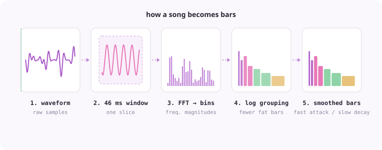

I have a weird, very old obsession: things that move *exactly* with music.

Audio spectrums bouncing on a bass drop. Lights hitting on the snare. A word landing on screen the same millisecond the rapper says it. I don't fully know where it comes from, probably the YouTube videos I was glued to as a kid, but it never left. I've been chasing that feeling for like ten years, from games to tools I built myself.

So here's a little tour of it. With some stuff you can actually play with.

## The first thing that got me · Geometry Dash

I've been playing **Geometry Dash** since 2015. And I don't just mean "a hard platformer". The top levels today are genuinely works of art. Pixel-perfect sync, where every jump, every color flash, every camera shake is placed *on* the music, by hand, by a person who heard that exact moment and decided it mattered.

That's the thing most people miss. The hard part isn't lining up with the beat. A computer can find the beat. The hard part is a human going "*this* snare, right here, is the one worth a flash. Not that one." Taste, basically. It's authored, not detected.

GD even has this clever little tool in the editor: you pick a color, you listen to the track, and you tap when something interesting happens, dropping a marker so you remember "there's something here". I'm telling you about that one because I straight up stole the idea a few years later (we'll get there).

## The engineering cousin · osu!

I never actually played **osu!**. But I always respected the tech behind it. Community-made beatmaps, timing points, BPM and offset dialed in so the whole map locks to the song.

It's impressive sync. Honestly tho, to me it's a little less *creative* than GD, because the map mostly follows the music. It traces it. GD reinterprets it. Both are cool, but one is engineering and the other is closer to an art form. That difference is basically the whole point of this post.

## The YouTube era · Proximity and the spectrum

Now the nostalgia. **Proximity**.

If you were anywhere near electronic music on YouTube in the 2010s, you know the look. Proximity started in 2009, and around 2013 it switched to the format everyone copied: a still wallpaper, the logo, and this audio spectrum bouncing along the bottom. That spectrum was half the reason you clicked. One static image plus one moving thing, and it felt completely alive.

At some point I didn't just want to watch it. I wanted to build it. And that's how I fell into the rabbit hole of **FFT**.

Here's the whole trick, no math degree required:

> A song is just numbers. 44,100 of them per second, each one the position of your speaker cone at that instant. That's all audio is.

To draw bars, you go frame by frame:

- **Grab a slice.** Take a small chunk, say 2,048 samples, about 46 milliseconds of sound.
- **Smooth the edges** of that chunk (a "window"), otherwise cutting the sound abruptly creates fake noise that isn't really in the music.
- **FFT it.** The Fast Fourier Transform turns "speaker position over time" into "how much of each frequency is in this slice". Out comes ~1,000 bins, each about 21 Hz wide.
- **Group them on a log scale.** Your ears hear logarithmically, so you give bass a few bins per bar and treble a lot. Skip this and all the action squishes into the first three bars.
- **Smooth over time.** Bars shoot up instantly and fall slowly. That "fast attack, slow decay" is the entire reason it looks musical instead of twitchy.

Then you just do that once per video frame. Slide the window forward 1/60th of a second, FFT again, draw again. A whole Proximity video is literally one FFT per frame, stacked into 60 frames a second.

Easier to feel it than read it. Here's a live one, procedural, running in your browser right now. Mess with the modes:

:::spectrum

The radial one still gets me every time.

## The one I actually built · Lyriks

2018. I built a game called **Lyriks**.

The idea: an interactive music video. The lyrics of a song pop onto the screen, in sync with the voice, in a smooth and sometimes unpredictable, beautiful way, and you tap each word as it lands. Rap tracks were the best levels by far, because the density of syllables turns it into this frantic, satisfying dance.

Take the opening of "Lose Yourself":

> His palms are swea-ty, knees weak, arms are hea-vy  
> There's vo-mit on his swea-ter al-rea-dy, mom's spa-ghet-ti

Read that out loud and watch where the stress lands. That's not words. That's *syllables*, each one on its own little beat. Here's a playable version so you see what I mean (it's visual only, no audio, I'm not about to host Eminem's master on my blog):

:::lyriks

Now the part nobody warned me about. The game was the easy bit. The nightmare was *syncing* the lyrics.

### The tooling was awful

I went looking for how people sync lyrics, karaoke-style. What I found was ugly and unintuitive. The "pro" workflow was basically a spreadsheet: one column of words, one column of timings, typed in by hand. Line by line. It took me around **5 hours** to sync a single song. For a rap track, soul-crushing.

So I thought about GD again. That color-marker tool, where you just listen and tap when something matters. Why isn't syncing lyrics like *that*?

### Lyriks Studio

So I built the tool I wanted. **Lyriks Studio**.

You pasted the entire lyrics in one go. Studio would decompose every word into **syllables** automatically. Then it played the track in slow motion, and you just tapped once per syllable as you heard it. That's it.

> 5 hours became 10 minutes.

Same idea as the GD marker, pointed at a different problem. Paste once, hear it slow, tap the moments. The whole thing clicked.

And this was all pre-AI. I'm pretty sure today you could automate the entire pipeline: forced alignment (Whisper-style) to get syllable timings, stem separation to pull the kicks and snares and bass apart, transient detection to mark the hits. The 10-minute job is heading toward zero. Kind of the whole "intelligence is a consumable" thing again, but for a job I did by hand with my ears.

### No, you can't just steal it from Spotify

People always ask this. "Doesn't Spotify already have synced lyrics?" Yeah, and it's not enough, not even close.

Spotify-style synced lyrics are **word** granularity. One timestamp per word. For a karaoke highlight, fine. For something that actually feels *alive*, you need **syllable** granularity, plus timed metadata the big providers simply don't expose: where the **kicks** are, the **snares**, the **bass**, the **section** boundaries.

That's the difference between a line lighting up and a word *exploding* onto the screen exactly on the hit. The data for the second one basically doesn't exist publicly. Which is exactly *why* the authoring tool had to exist in the first place.

## Where this lives now · clubs and light shows

This whole thing isn't niche anymore, it's an industry.

Walk into a serious club or a festival main stage and the visuals and lights aren't reacting live to a mic. They're authored. Tools like Resolume, TouchDesigner, MadMapper for the visuals. **DMX** and timecode (**SMPTE**, Ableton Link) to lock lights to the track down to the frame. Lasers, pixel-mapped LED walls, the whole Sphere-in-Vegas level of it.

And here's the funny part: it's the exact same lesson as a Geometry Dash level. The best shows aren't the ones that react to the sound. They're the ones a human sat down and *authored* to the sound, moment by moment, deciding what matters.

## The throughline

Detecting the beat is easy. Deciding which beat matters is the whole art.

GD levels, osu! maps, Proximity spectrums, Lyriks, a laser show. All the same move underneath: someone heard a moment and decided to mark it. The tools keep getting better, and soon the AI will mark most of the obvious ones for you. But picking the one that actually hits, out of the thousand that don't, that part stays human for a while.

That's the part I've been in love with since 2015 honestly. Marking the moment.
